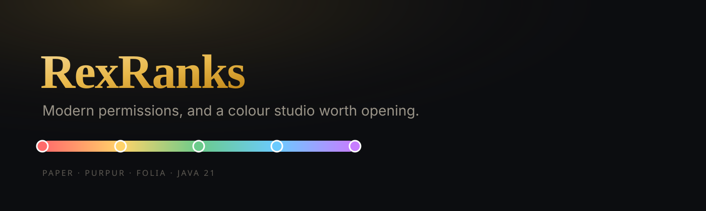

<p align="center">
  <a href="https://rexsystems.me">
    
  </a>
</p>

<p align="center">
  <strong>Modern permissions for Minecraft servers.</strong><br>
  Groups, tracks, temporary nodes, MiniMessage prefixes, and a web editor whose colour studio is the part you'll actually enjoy using.
</p>

<p align="center">
  <a href="https://github.com/rexsystems/RexRanks/releases"></a>
  <a href="https://modrinth.com/plugin/rexranks"></a>
  <a href="https://rexsystems.me"></a>
  
  
</p>

<p align="center">
  
  
  
  
  
  
</p>

---

## Why RexRanks?

RexRanks is a from-scratch permissions plugin for Paper, Purpur and Folia. It has the pieces you expect from a modern permission system — inheritance, wildcards, negation, temporary nodes, weighted prefixes, promotion tracks, YAML or SQL storage, Vault and PlaceholderAPI — and two things we wanted to do better:

- **A real web editor**, served either from the plugin itself or from a small Node host, with a clear apply/diff flow.
- **A colour studio** for prefixes and suffixes: multi-stop gradients with drag-able handles, RGB or HSV interpolation, easing, rainbows, decorations, live Minecraft-style previews (chat, tab list, nametag), and one-click MiniMessage / legacy hex output.

There is also an in-game workshop (`/rr color`) that mirrors the same formatter, including a dyed-leather GUI picker.

---

## Highlights

| Permissions | Editor & colour | Ops & integrations |
|---|---|---|
| Groups, users and weighted inheritance | Integrated web editor (`/rr editor`) | Vault permission + chat providers |
| Wildcards, negation and regex nodes | Remote editor host for networks | PlaceholderAPI expansion |
| Temporary permissions (`1d2h`, `7 days`) | Multi-stop gradient builder | LuckPerms JSON/YAML import |
| Contexts (`world`, `server`, gamemode, dimension) | RGB / HSV, easing, rainbow, decorations | Redis, database and plugin-messaging sync |
| Promotion tracks (`promote` / `demote`) | MiniMessage, precise and legacy hex | H2, SQLite, MySQL / MariaDB, YAML |
| MiniMessage prefixes, suffixes, display names | In-game colour workshop + GUI | Folia-safe schedulers, public Java API |

---

## Installation

1. Download the latest JAR from [GitHub Releases](https://github.com/rexsystems/RexRanks/releases) (or [Modrinth](https://modrinth.com/plugin/rexranks) once the listing is live).
2. Drop it into your server's `plugins/` folder.
3. Restart the server. RexRanks loads at `STARTUP`.
4. Edit `plugins/RexRanks/config.yml` — the default `h2` storage needs no extra setup.
5. Optionally import an existing LuckPerms export: `/rr import luckperms <file>`.

**Requirements:** Paper / Purpur / Folia **1.20.4+**, **Java 21**.

Coming from LuckPerms? Export with LuckPerms (`/lp export`), copy the file into the RexRanks plugin folder, and run `/rr import luckperms <file>`.

---

## Web editor

Run `/rr editor` (or `/rr editor user <name>` / `/rr editor group <name>`). You'll get a clickable, time-limited link.

**Integrated mode** (default) — the plugin serves the UI on `editor.port` (7780). Staff open the link, edit, and apply immediately. Set `editor.public-url` if the bound address isn't what you want people to click.

**Remote mode** — for networks that shouldn't expose a port on every backend. Host the editor once (Docker or `node`), point `editor.remote-url` at it, and `/rr editor` uploads a snapshot. After editing, run `/rr apply <code>` on the server.

```yaml
editor:
  enabled: true
  mode: integrated          # or "remote"
  host: 0.0.0.0
  port: 7780
  public-url: ""
  token-lifetime-minutes: 120
  remote-url: "http://127.0.0.1:7781"
```

### Hosting the remote editor

```bash
cd web
npm ci
npm run build
PUBLIC_URL=https://editor.example.com PORT=7781 npm run server
```

Or, from `web/` after a build:

```bash
PUBLIC_URL=https://editor.example.com docker compose -f server/docker-compose.yml up --build -d
```

Full API and environment notes are in [`web/server/README.md`](web/server/README.md). The colour studio also works as a public demo (no session required) — useful as a MiniMessage playground.

---

## Colour studio

The standout of the editor, also available in game as `/rr color`:

- Solid colours, multi-stop gradients and rainbows
- Drag-able stops, click-to-add, keyboard nudge, distribute and reverse
- RGB or HSV interpolation, and easing (linear, ease-in/out, sine) for precise / legacy output
- Live previews in a Minecraft-style chat box, tab list and nametag
- Bold, italic, underline, strikethrough and obfuscated decorations
- Compact MiniMessage (`<gradient:#a:#b>…</gradient>`), per-character precise MiniMessage, and `&#RRGGBB` legacy
- Preset gallery, colour harmonies, and import of existing MiniMessage / legacy strings
- Apply directly to a group or user prefix/suffix (priority included)

```
/rr color solid #e8b84a Staff
/rr color gradient #ff6b6b #ffd36a #6bcbff VIP
/rr color rainbow !
/rr color apply prefix g:admin 100
/rr color gui
```

---

## Commands

Aliases: `/rexranks`, `/rr`, `/rank`, `/ranks`, `/perm`, `/permissions`.

| Command | Description | Permission |
|---|---|---|
| `/rr user <user> …` | Inspect and edit a user | `rexranks.user` |
| `/rr group <group> …` | Inspect and edit a group | `rexranks.group` |
| `/rr track <track> …` | Manage promotion tracks | `rexranks.track` |
| `/rr editor [user\|group] [name]` | Open the web editor | `rexranks.editor` |
| `/rr apply <code>` | Apply a remote editor session | `rexranks.apply` |
| `/rr color …` | Colour / gradient workshop | `rexranks.color` |
| `/rr check <user> <node>` | Test a permission | `rexranks.check` |
| `/rr verbose` | Toggle permission spy | `rexranks.verbose` |
| `/rr search <node>` | Find who has a node | `rexranks.search` |
| `/rr tree [group]` | Print inheritance | `rexranks.group` |
| `/rr import luckperms <file>` | Import a LuckPerms export | `rexranks.import` |
| `/rr export [file]` | Export all data as JSON | `rexranks.export` |
| `/rr bulkupdate …` | Bulk set or unset nodes | `rexranks.bulkupdate` |
| `/rr sync [pull\|push]` | Network synchronisation | `rexranks.sync` |
| `/rr info` | Plugin and storage status | `rexranks.info` |
| `/rr reload` | Reload config and messages | `rexranks.reload` |
| `/rr migrate <yaml\|h2\|sqlite>` | Copy data to another backend | `rexranks.admin` |

User actions include `info`, `permission`, `parent`, `meta`, `promote`, `demote`, `editor`, `clear`, `clone`, `showtracks` and `switchprimary`. Group actions include `create`, `delete`, `setweight`, `setdisplayname`, `rename` and `clone`. Durations such as `1d2h`, `30m` and `7 days` are accepted on temporary nodes.

---

## Permissions (essentials)

| Permission | Default | Description |
|---|---|---|
| `rexranks.use` | `op` | Access to `/rr` |
| `rexranks.admin` | `op` | Full access (all children below) |
| `rexranks.user` | `op` | Manage users |
| `rexranks.group` | `op` | Manage groups |
| `rexranks.track` | `op` | Manage tracks |
| `rexranks.editor` | `op` | Open the web editor |
| `rexranks.color` | `op` | Use the colour workshop |
| `rexranks.apply` | `op` | Apply a remote editor session |

See `plugin.yml` for the complete list (`rexranks.verbose`, `rexranks.check`, `rexranks.sync`, `rexranks.reload`, `rexranks.import`, `rexranks.export`, `rexranks.search`, `rexranks.bulkupdate`, `rexranks.info`).

---

## PlaceholderAPI

| Placeholder | Returns |
|---|---|
| `%rexranks_prefix%` | Highest-weight prefix |
| `%rexranks_suffix%` | Highest-weight suffix |
| `%rexranks_group%` / `%rexranks_primary%` | Primary group name |
| `%rexranks_display%` | Display name, or the primary group |
| `%rexranks_groups%` | Inherited groups, comma-separated |
| `%rexranks_weight%` | Effective weight |
| `%rexranks_username%` | Stored username |
| `%rexranks_meta_<key>%` | Meta value |
| `%rexranks_has_permission_<node>%` | `true` / `false` |
| `%rexranks_in_group_<group>%` | `true` / `false` |
| `%rexranks_expires_<node>%` | Remaining duration, if temporary |

---

## Storage & sync

`storage.type` can be `h2` (default, recommended), `sqlite`, `mysql` / `mariadb`, or `yaml`. `/rr migrate <yaml|h2|sqlite>` copies the current data set into a sibling folder so you can switch backends after a restart.

Cross-server sync is off by default. Enable it and pick one or more methods: `database` (polls `updated_at` on MySQL), `redis` (pub/sub), and `plugin-messaging` (via the proxy). `/rr sync push` and `/rr sync pull` force a cycle.

---

## Developer API

Depend on `me.rexsystems:rexranks-api` (or the plugin JAR) and obtain the service once RexRanks is enabled:

```java
RexRanks api = RexRanksProvider.get();

api.getUserManager().loadUser(player.getUniqueId()).thenAccept(user -> {
    user.data().add(Node.permission("essentials.fly"));
    user.data().add(Node.prefix(100, "<gradient:#ff6b6b:#ffd93d>[Admin] "));
    api.getUserManager().saveUser(user);
});

api.getEventBus().subscribe(myPlugin, UserPromoteEvent.class, event -> {
    // ...
});
```

The API module is also available from this repository's `rexranks-api` artifact. Events cover permission changes, group changes, promote/demote, node expiry and data reloads.

---

## Building from source

**Requirements:** JDK 21, Maven 3.9+, Node.js 22 (for the web editor).

```bash
git clone https://github.com/rexsystems/RexRanks.git
cd RexRanks
cd web && npm ci && npm test && npm run build && cd ..
mvn package
```

`mvn package` also runs `npm run build` and shades the SPA into the plugin JAR (served at `/` by the integrated editor). Skip that step with `-DskipWeb=true` if `web/dist` is already built. The shaded JAR is `rexranks-plugin/target/RexRanks-<version>.jar`.

---

## Links

- **Website:** [rexsystems.me](https://rexsystems.me)
- **GitHub:** [rexsystems/RexRanks](https://github.com/rexsystems/RexRanks)
- **Modrinth:** [rexranks](https://modrinth.com/plugin/rexranks) (listing may follow the first release)
- **Changelog:** [CHANGELOG.md](CHANGELOG.md)
- **Editor host:** [web/server/README.md](web/server/README.md)
- **Modrinth description:** [modrinth.md](modrinth.md)

---

## License

RexRanks is licensed under the **GNU Affero General Public License v3.0**. See [LICENSE](LICENSE) and [NOTICE](NOTICE). The remote editor host is part of the same work and is also AGPL-3.0.

<p align="center">
  <sub>Made with ☕ by <a href="https://rexsystems.me">RexSystems</a></sub>
</p>
